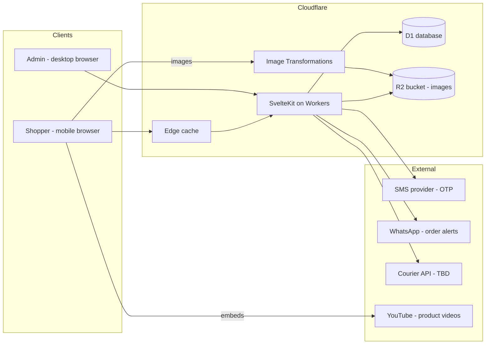
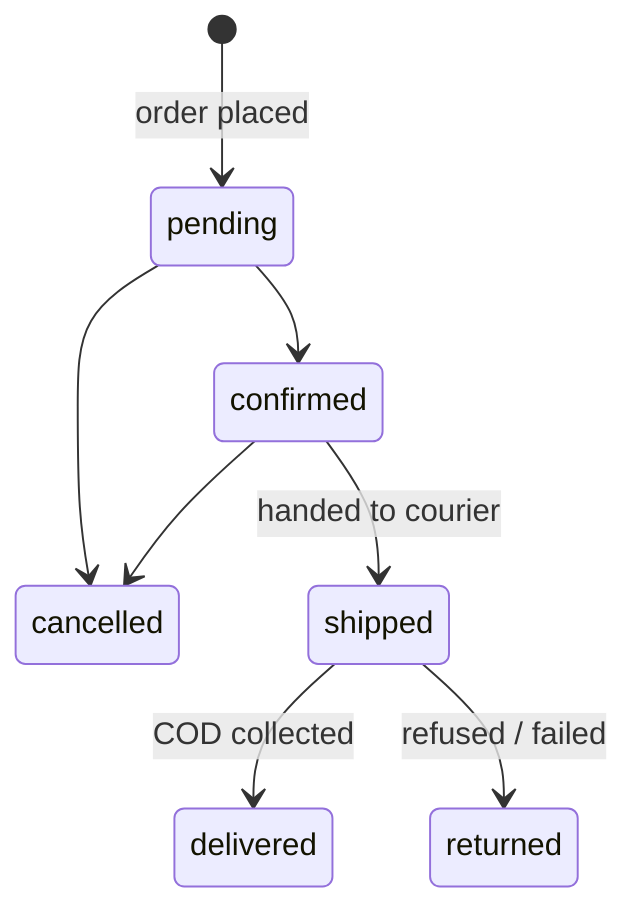

# Bagvaly — Architecture

> Ladies' bag e-commerce site for Bangladesh. Repo: `github.com/ezaz-ahmed/bagvaly`
>
> This document is the source of truth for how the system is built. Coding agents working from GitHub issues should read it before making changes, and update it when a change alters anything described here.

---

## 1. Goals & constraints

| Area             | Decision                                                    |
| ---------------- | ----------------------------------------------------------- |
| Audience         | ~90% Bangladesh, mobile-first shoppers                      |
| Scale target     | ~50k visits / month                                         |
| Hosting budget   | Near-zero — pay only for domain (+ SMS)                     |
| Catalogue growth | ~20–30 products / month, ~4 images each                     |
| Payments         | **Cash on delivery only** at launch (no gateway)            |
| Marketing        | Facebook, Instagram, Telegram ads drive traffic to the site |
| Admin            | Used mostly on desktop                                      |

Guiding principles:

1. **Stay inside Cloudflare's free tiers.** Every new dependency must justify its cost.
2. **Fast on slow 4G.** SSR, small JS bundles, optimized images, edge caching.
3. **Simple to operate.** One deploy target (Workers), one database (D1), one bucket (R2).
4. **Agent-friendly codebase.** Clear module boundaries, typed everything, small focused issues.

---

## 2. Tech stack

| Layer             | Choice                                                     |
| ----------------- | ---------------------------------------------------------- |
| Framework         | SvelteKit (TypeScript) with `@sveltejs/adapter-cloudflare` |
| Build tooling     | Vite+ (`vp`) on top of Vite                                |
| Styling           | Tailwind CSS                                               |
| Runtime / hosting | Cloudflare Workers                                         |
| Database          | Cloudflare D1 (SQLite)                                     |
| Object storage    | Cloudflare R2 (product images)                             |
| Image delivery    | Cloudflare Image Transformations                           |
| Video             | YouTube embeds (not stored by us)                          |
| Auth              | Better Auth — phone number + SMS OTP                       |
| Order alerts      | WhatsApp                                                   |
| DNS / email       | Cloudflare DNS + Cloudflare Email Routing                  |

---

## 3. System overview



Shopper request path: edge cache → Worker (SSR) → D1. Images never pass through the Worker; the browser requests `/cdn-cgi/image/...` URLs that Image Transformations resolves from R2.

---

## 4. Repository layout

```
bagvaly/
├─ src/
│  ├─ routes/
│  │  ├─ (shop)/                 # public storefront
│  │  │  ├─ +page.svelte          # home / hero
│  │  │  ├─ bags/[slug]/          # product detail
│  │  │  ├─ category/[slug]/      # listing pages
│  │  │  ├─ cart/
│  │  │  ├─ checkout/
│  │  │  └─ orders/[id]/          # confirmation / tracking
│  │  ├─ (account)/              # OTP login, profile, order history
│  │  ├─ admin/                  # desktop-first admin (auth-guarded)
│  │  └─ api/                    # JSON endpoints (auth, uploads, webhooks)
│  ├─ lib/
│  │  ├─ server/
│  │  │  ├─ db/                   # schema, queries
│  │  │  ├─ auth.ts               # Better Auth instance
│  │  │  ├─ storage.ts            # R2 helpers
│  │  │  ├─ notify/               # WhatsApp + SMS adapters
│  │  │  ├─ courier/              # CourierAdapter interface + impls
│  │  │  └─ orders/               # order service, status transitions
│  │  ├─ components/
│  │  ├─ images.ts               # builds /cdn-cgi/image URLs
│  │  └─ types.ts
│  ├─ app.css                    # Tailwind + design tokens
│  └─ hooks.server.ts            # session loading, admin guard
├─ migrations/                   # D1 SQL migrations
├─ static/
├─ wrangler.jsonc
├─ ARCHITECTURE.md
└─ README.md
```

Rule: **all D1/R2/external calls live in `src/lib/server/`**. Routes call services, never bindings directly.

---

## 5. Data model (D1)

Better Auth owns its tables (`user`, `session`, `account`, `verification`). App tables:

| Table             | Key columns                                                                                                                                  |
| ----------------- | -------------------------------------------------------------------------------------------------------------------------------------------- |
| `category`        | id, slug, name, sort_order                                                                                                                   |
| `product`         | id, slug, title, description, category_id, base_price (integer BDT), status (`draft`/`active`/`archived`), youtube_id, created_at            |
| `product_variant` | id, product_id, color, sku, price_override, stock                                                                                            |
| `product_image`   | id, product_id, r2_key, alt, sort_order                                                                                                      |
| `address`         | id, user_id, name, phone, division, district, area, line1, notes                                                                             |
| `order`           | id, user_id (nullable for guests), phone, address snapshot (JSON), subtotal, delivery_fee, total, status, courier, tracking_code, created_at |
| `order_item`      | id, order_id, variant_id, title snapshot, unit_price, qty                                                                                    |
| `order_event`     | id, order_id, from_status, to_status, actor, note, created_at                                                                                |

Conventions:

- Money is **integer BDT**, never floats.
- Orders **snapshot** title, price and address so later edits don't rewrite history.
- Schema changes are new numbered files in `migrations/`; never edit an applied migration.

---

## 6. Key flows

### 6.1 Authentication (phone + OTP)

1. User enters a BD number, normalized to `+8801XXXXXXXXX`.
2. Better Auth's phone-number plugin generates an OTP and calls the SMS adapter.
3. User submits OTP → session cookie issued.
4. Admin is a role on `user`, enforced in `hooks.server.ts` for `/admin/**`.

OTP endpoints are rate-limited per phone and per IP to cap SMS spend.

### 6.2 Checkout (COD)



1. Cart lives client-side; prices are **re-validated on the server** at checkout.
2. Order, items, stock decrement and first `order_event` are written in one D1 batch.
3. WhatsApp alert goes to the shop; customer sees a confirmation page.
4. Every status change goes through the `orders/` service and records an `order_event`.

COD carries fake-order risk, so `pending → confirmed` is a deliberate step (see open decisions).

### 6.3 Product images

1. Admin uploads in the admin panel; original stored in R2 at `products/{productId}/{uuid}.{ext}`.
2. `src/lib/images.ts` builds URLs like `/cdn-cgi/image/width=600,quality=80,format=auto/products/...`.
3. Use a fixed set of widths (e.g. 320 / 600 / 1200) with `srcset` to keep unique transformations low.

### 6.4 Product videos

YouTube only. `product.youtube_id` stores the ID; the page shows a lightweight thumbnail and loads the iframe on tap.

---

## 7. Caching & performance

- Public catalogue pages: SSR with `Cache-Control` so the edge serves repeats; short TTL or purge after admin edits.
- Cart, checkout, account, admin: never cached.
- Minimal JS; prefer SvelteKit form actions.
- Self-hosted, subset fonts; preload only the above-the-fold heading weight.

---

## 8. Free-tier budget (rough)

~50k visits/month (≈250–500k requests) sits comfortably inside Workers, D1 and R2 free allowances, and ~25 products × 4 images × 3 widths fits Image Transformations' free monthly quota. Paid items: **domain** and **SMS OTP**. Re-check Cloudflare's current limits before launch and before large ad pushes.

---

## 9. Design system

| Token                        | Value                                 |
| ---------------------------- | ------------------------------------- |
| `--color-primary` (Burgundy) | `#790B27`                             |
| `--color-bg` (Ivory)         | `#FDF7EB`                             |
| `--color-accent`             | `#B99A6B`                             |
| `--color-text`               | `#292525`                             |
| `--color-surface`            | `#E8DCCF`                             |
| Heading font                 | Fraunces (SOFT axis, optical size on) |
| Body font                    | Manrope                               |

Tokens live in `app.css` and feed the Tailwind theme. Hero: modern yet elegant — bold type with lifestyle shots of women carrying different bags. Storefront mobile-first; admin desktop-first.

---

## 10. Environments & deployment

| Env        | Purpose                               | Resources        |
| ---------- | ------------------------------------- | ---------------- |
| local      | `vp dev` with Wrangler local bindings | local D1 + R2    |
| staging    | pre-release checks (`env.staging`)    | separate D1 + R2 |
| production | live site                             | prod D1 + R2     |

- Bindings (`DB`, `R2`) are declared per environment in `wrangler.jsonc`. Secrets (auth secret, SMS key, WhatsApp token, courier keys) are set with `wrangler secret put` and listed in `secrets.required` — never committed. Locally, all values live in one ignored `.env` (no `.dev.vars`).
- CI (GitHub Actions): typecheck → lint → test → apply D1 migrations → deploy.
- Merges to `main` deploy to production.

---

## 11. Working with coding agents

- One GitHub issue = one focused change with clear acceptance criteria.
- Respect the boundaries in §4, add migrations rather than editing old ones, and update this file when architecture changes.
- PRs need passing CI and human review before merge.

---

## 12. Open decisions

| Topic           | Status                                                                                   |
| --------------- | ---------------------------------------------------------------------------------------- |
| Courier         | Comparing Steadfast, Pathao, Fast Track — build behind `CourierAdapter` so it can change |
| COD fraud check | Under consideration (checkout OTP, courier delivery-history lookup, manual confirm call) |
| SMS provider    | To choose (BD provider with good delivery rates)                                         |
| WhatsApp method | Cloud API vs. business app                                                               |
| Ad tracking     | Meta Pixel / Conversions API for FB & IG campaigns                                       |
| Payment gateway | Out of scope for launch                                                                  |
| Brand motto     | Not chosen yet                                                                           |
